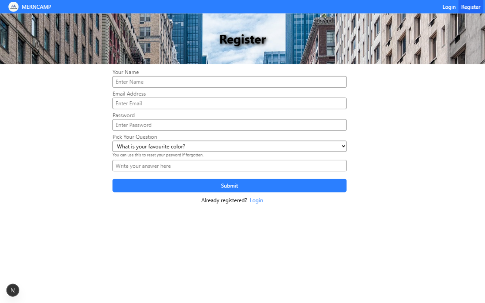
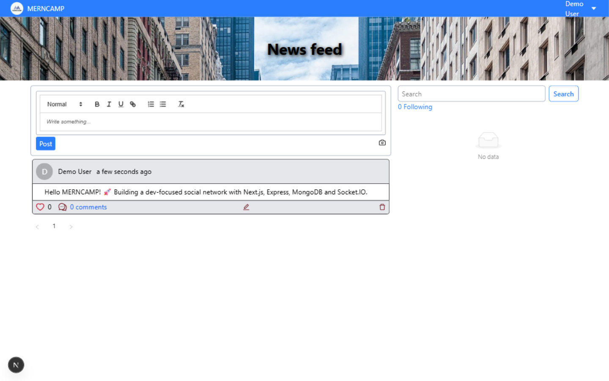
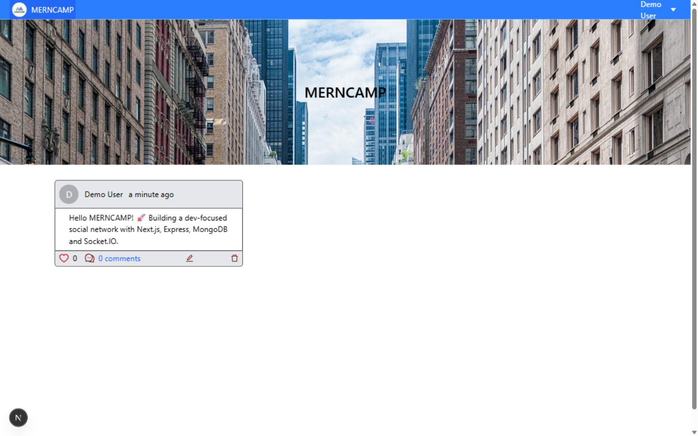

# MERNCAMP Client — Social Network Frontend

The **frontend** of MERNCAMP, a **social network built by devs for devs**, powered by **Next.js 15, React 18, Tailwind CSS 4, and Ant Design**. This app connects to the [merncamp-server](https://github.com/alijamshidy/merncamp-server) REST API and features a real-time news feed via Socket.IO, rich-text posting with Quill, and user follow/unfollow functionality.

---

## 📸 Screenshots

| Register | Dashboard — post form + news feed |
|----------|-----------------------------------|
|  |  |

| Home feed — parallax hero + real-time posts |
|---------------------------------------------|
|  |

---

## ✨ Features

### 📰 **News Feed**
- Real-time news feed powered by **Socket.IO** — new posts appear instantly without refresh
- Paginated post loading
- Parallax hero background on the home page

### ✍️ **Posting**
- Rich-text post creation with **Quill** editor
- Image upload for posts (stored server-side on Cloudinary)
- Edit and delete your own posts
- Single post view with media rendering

### ❤️ **Social Interactions**
- Like / Unlike posts
- Comment on posts and remove your own comments
- Follow / Unfollow other users
- "Find People" suggestions
- View user profiles and their posts

### 🔐 **Authentication & Profile**
- User registration and login (JWT + user object persisted in `localStorage` under the `auth` key)
- Axios response interceptor for automatic logout on `401`
- Password recovery with a personal secret question
- Profile update (name, about, image)
- Route protection with `UserRoute` and `AdminRoute` components

### 🔎 **Discovery**
- User search
- Follower / Following lists

### 🛡 **Admin**
- Admin dashboard with post moderation (delete any post)

### 🎨 **UI/UX**
- Responsive design (mobile, tablet, desktop)
- **Ant Design** components + **Tailwind CSS 4** utility styling
- Toast notifications with **react-toastify**
- Date formatting with **moment**

---

## 🛠 Tech Stack

**Frontend Framework:**
- [Next.js 15](https://nextjs.org/) - React framework (Pages Router)
- [React 18](https://react.dev/) - UI library

**Styling:**
- [Tailwind CSS 4](https://tailwindcss.com/) - Utility-first CSS framework
- [Ant Design 5](https://ant.design/) - Enterprise-grade UI components
- [PostCSS](https://postcss.org/) - CSS transformations

**State & Data:**
- [React Context](https://react.dev/learn/scaling-up-with-reducer-and-context) - Global auth state (user + token)
- [Axios](https://axios-http.com/) - HTTP client with auth interceptors

**Real-time:**
- [Socket.IO Client](https://socket.io/) - Live news feed updates

**Rich Content:**
- [React Quill](https://github.com/zenoamaro/react-quill) / [Quill 2](https://quilljs.com/) - Rich-text editor
- [html-react-parser](https://github.com/remarkablemark/html-react-parser) - Render post HTML content

**Utilities:**
- [moment](https://momentjs.com/) - Date formatting
- [react-toastify](https://fkhadra.github.io/react-toastify/) - Notifications

---

## 💻 Installation

### Prerequisites
- Node.js (v18 or later)
- npm or yarn
- Git
- A running instance of [merncamp-server](https://github.com/alijamshidy/merncamp-server)

### Quick Start

1. **Clone the repository:**
   ```bash
   git clone https://github.com/alijamshidy/merncamp-client.git
   cd merncamp-client
   ```

2. **Install dependencies:**
   ```bash
   npm install
   # or
   yarn install
   ```

3. **Set up environment variables:**
   ```bash
   cp .env.example .env.local
   ```
   Edit `.env.local` file with your configuration (see [Environment Variables](#-environment-variables))

4. **Run the development server:**
   ```bash
   npm run dev
   # or
   yarn dev
   ```

5. **Build for production:**
   ```bash
   npm run build
   npm run start
   ```

The application will start at `http://localhost:3000`

---

## ⚙ Environment Variables

Create a `.env.local` file in the root directory and add the following variables:

```env
# REST API base URL (merncamp-server)
NEXT_PUBLIC_API=http://localhost:8000/api

# Socket.IO server URL (merncamp-server)
NEXT_PUBLIC_SOCKETIO=http://localhost:8000
```

---

## 📁 Folder Structure

```
merncamp-client/
├── components/              # React components
│   ├── cards/               # Card components
│   │   ├── ParallaxBG.jsx   # Parallax background
│   │   ├── People.jsx       # People suggestions
│   │   ├── Post.jsx         # Single post card
│   │   └── PostList.jsx     # Post list
│   ├── forms/               # Form components
│   │   ├── AuthForm.jsx     # Login / Register form
│   │   ├── CommentForm.jsx  # Comment form
│   │   ├── ForgotPasswordForm.jsx
│   │   └── PostForm.jsx     # Post create / update form
│   ├── images/
│   │   └── PostImage.jsx    # Post image display
│   ├── routes/              # Route guards
│   │   ├── AdminRoute.jsx   # Admin-only wrapper
│   │   └── UserRoute.jsx    # Logged-in-only wrapper
│   ├── Nav.jsx              # Navigation bar
│   └── Search.jsx           # User search
├── context/                 # React Context
│   └── index.js             # UserContext (auth state + axios setup)
├── functions/               # (currently empty — API/config logic lives in context/index.js)
├── pages/                   # Next.js Pages Router
│   ├── _app.js              # App wrapper + UserProvider
│   ├── _document.jsx        # HTML document setup
│   ├── index.jsx            # Home / news feed
│   ├── login.jsx            # Login page
│   ├── register.jsx         # Registration page
│   ├── forgot-password.jsx  # Password recovery
│   ├── admin/
│   │   └── index.jsx        # Admin dashboard
│   ├── post/
│   │   ├── [_id].jsx        # Edit post
│   │   └── view/[_id].jsx   # View single post
│   └── user/
│       ├── [username].jsx   # Public profile
│       ├── dashboard.jsx    # User dashboard
│       ├── following.jsx    # Followers / Following
│       ├── post/[_id].jsx   # User post view
│       └── profile/update.jsx # Profile settings
├── public/                  # Static assets
│   ├── css/
│   └── images/
├── postcss.config.mjs
├── tsconfig.json
└── package.json
```

---

## 🚀 Demo

### Run the application locally:
```bash
npm run dev
```

### Access the application:
- **Homepage / News Feed:** `http://localhost:3000`
- **Login:** `http://localhost:3000/login`
- **Register:** `http://localhost:3000/register`
- **User Dashboard:** `http://localhost:3000/user/dashboard`
- **Admin Dashboard:** `http://localhost:3000/admin`

> ⚠️ The API server ([merncamp-server](https://github.com/alijamshidy/merncamp-server)) must be running and both apps must share the same URLs configured in their environment variables.

> ⚠️ **Known limitation:** the home page feed URL is hardcoded to `http://localhost:8000/api/posts` in `pages/index.jsx` (`getServerSideProps`). If you deploy the backend elsewhere, update that line too — every other request correctly uses `NEXT_PUBLIC_API`.

---

## 📦 Available Scripts

| Script | Description |
|--------|-------------|
| `npm run dev` | Start development server |
| `npm run build` | Build for production |
| `npm run start` | Start production server |

---

## 🤝 Contributing

Contributions are welcome! Please follow these steps:

1. Fork the repository
2. Create your feature branch (`git checkout -b feature/AmazingFeature`)
3. Commit your changes (`git commit -m 'Add some AmazingFeature'`)
4. Push to the branch (`git push origin feature/AmazingFeature`)
5. Open a Pull Request

---

## 📜 License

This project is **private** and all rights are reserved.

---

## 🆘 Support

For support, please open an issue or contact the maintainer.

---

## 🏷 Topics

`nextjs`, `react`, `social-network`, `mern`, `mern-stack`, `tailwindcss`, `antd`, `socket-io`, `quill`, `news-feed`, `frontend`
